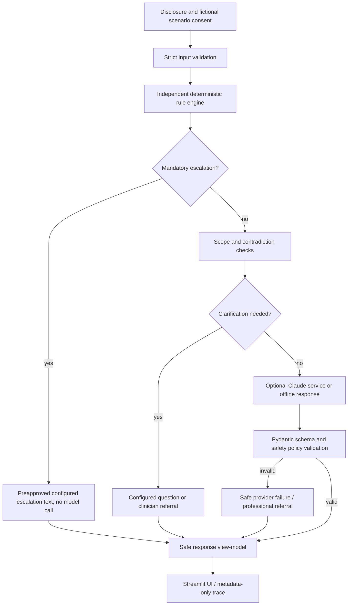

# Safety architecture

The engine owns escalation, including an irreversible session escalation latch. The provider cannot create an escalation rule, clear a prior escalation, define a clinical category, or bypass the deterministic policy. Invalid schema/model output fails closed. Clinical rule status is checked at application startup; unapproved rules are usable only in explicitly labelled demo mode. There is no active clinical deployment setting in this repository.

## State transitions

```mermaid
stateDiagram-v2
  [*] --> DISCLOSURE
  DISCLOSURE --> COLLECTION: accept fictional scenario disclaimer
  COLLECTION --> EVALUATING: validated message
  CLARIFICATION --> EVALUATING: answer
  EVALUATING --> EMERGENCY: triggered demo emergency rule
  EVALUATING --> URGENT: triggered demo urgent rule
  EVALUATING --> CLARIFICATION: allowed protocol question
  EVALUATING --> GENERAL_INFO: configured information rule
  EVALUATING --> UNSUPPORTED: unsupported request
  EVALUATING --> PROVIDER_FAILURE: provider or output invalid
  EVALUATING --> CLINICIAN_REFERRAL: uncertain / contradictory / limit
  EMERGENCY --> EMERGENCY: sticky; cannot downgrade
  URGENT --> URGENT: sticky without authorized correction
  GENERAL_INFO --> EVALUATING: new message
  UNSUPPORTED --> EVALUATING: new message
  PROVIDER_FAILURE --> EVALUATING: new message
  CLINICIAN_REFERRAL --> EVALUATING: new message
  CLARIFICATION --> COMPLETE: end
  GENERAL_INFO --> COMPLETE: end
  UNSUPPORTED --> COMPLETE: end
  CLINICIAN_REFERRAL --> COMPLETE: end
  COMPLETE --> DISCLOSURE: restart with new session
```

State transition enforcement is performed by `conversation/state.py`. Restart discards the in-memory narrative and latch; no persistent storage is enabled.
